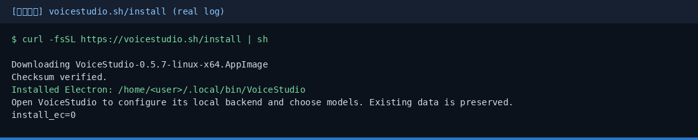
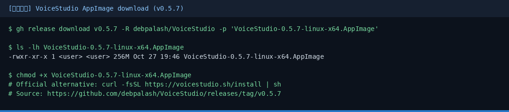
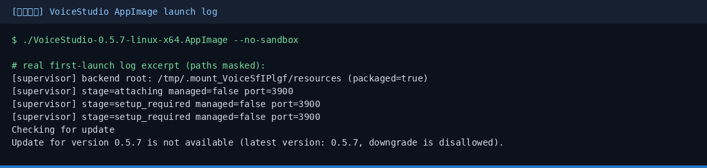
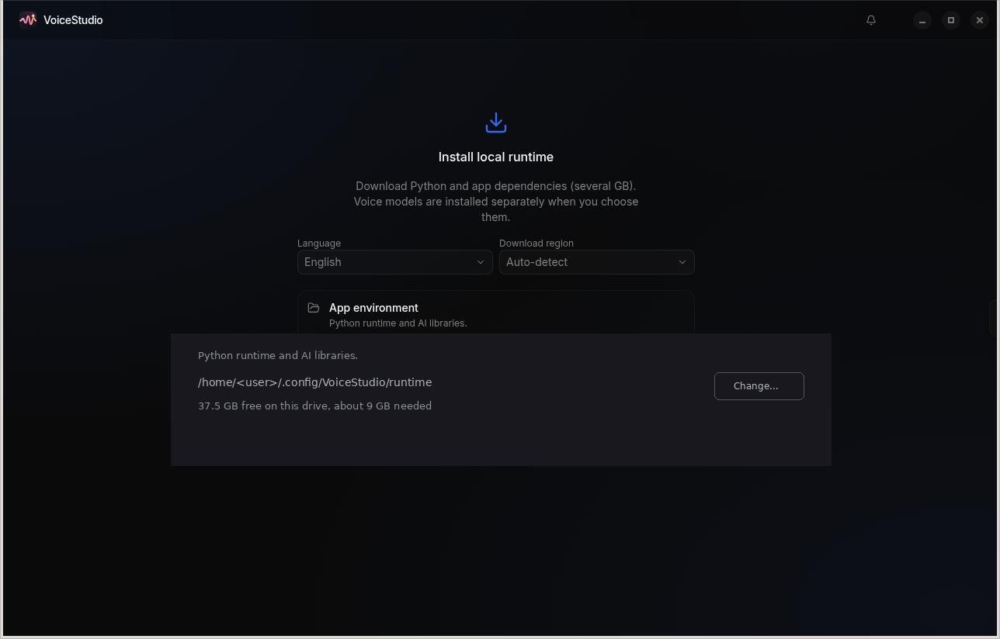
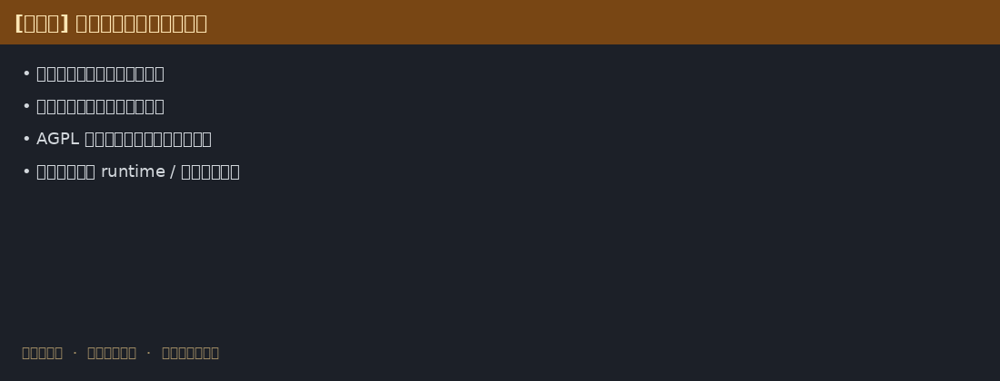

# VoiceStudio 小白中文教程

> **debpalash/VoiceStudio** 开源语音克隆 / 配音 / 听写 / 有声书 · 社区非官方中文入门  
> 上游：[`debpalash/VoiceStudio`](https://github.com/debpalash/VoiceStudio) · 官网：[voicestudio.sh](https://voicestudio.sh/)  
> 教程校对：2026-10-27（Asia/Shanghai）· 对照上游 **v0.5.7**（Electron）

[](https://github.com/xianyu110/awesome-voicestudio-zh)
[](https://github.com/debpalash/VoiceStudio)
[-green.svg)](LICENSE)
[](https://xianyu110.github.io/awesome-voicestudio-zh/)

---

## 截图索引

| # | 文件 | 类型 | 说明 |
|---|------|------|------|
| 1 | [`images/01-download.png`](images/01-download.png) | **真实** | AppImage v0.5.7 下载 |
| 2 | [`images/02-install-script.png`](images/02-install-script.png) | **真实** | `voicestudio.sh/install` 日志 |
| 3 | [`images/03-launch-log.png`](images/03-launch-log.png) | **真实** | AppImage 启动日志 |
| 4 | [`images/04-gui-runtime-setup.png`](images/04-gui-runtime-setup.png) | **真实** | Install local runtime GUI（路径已脱敏） |
| 5 | [`images/05-clone-consent-schematic.png`](images/05-clone-consent-schematic.png) | **示意图** | 克隆同意 / 模型步骤（未下载数 GB runtime） |

> 未登录账号、未输入 API Key；runtime 路径中的用户名已替换为 `<user>`。完整 runtime（约 9 GB）未在沙盒下载。

---

## 这是什么？

VoiceStudio 是开源桌面应用（当前 **仅 Electron** 桌面 / Web UI；0.5.3 为最后一版 Tauri），能力包括：

- **语音克隆**、语音设计、视频配音  
- 听写悬浮窗、转写、有声书 / 批量任务  
- 本地 API 与 MCP（给 Agent 用）  
- 默认引擎路线含 k2-fsa/OmniVoice 等（可换引擎，见官方 feature catalog）  
- 宣称支持大量语种工作流；本机算力跑本地流程，远程服务可选  

官方也提供简体中文文档入口（见上游 README 徽章「简体中文」）。本仓是**小白向中文导读**，不替代官方文档。

---

## 官方链接

| 资源 | 链接 |
|------|------|
| 官网 | https://voicestudio.sh/ |
| 源码 | https://github.com/debpalash/VoiceStudio |
| Releases | https://github.com/debpalash/VoiceStudio/releases |
| 一键安装脚本 | https://voicestudio.sh/install → 跳转到仓库 `scripts/install.sh` |
| 排障 | https://github.com/debpalash/VoiceStudio/blob/main/docs/install/troubleshooting.md |
| 许可说明 | https://github.com/debpalash/VoiceStudio/blob/main/LICENSE-NOTICE.md |
| Discord | 见上游 README |

---

## 许可证与负责任使用（必读）

| 内容 | 协议 |
|------|------|
| **本教程文案** | [MIT](LICENSE) |
| **VoiceStudio 上游应用** | **AGPL-3.0**（含商业使用应用本身的条件；若你修改并通过网络对外提供，须按 AGPL 提供对应源码） |

额外注意（摘自官方 License Notice / README）：

1. **模型权重、分词器、音色、生成物**另有各自条款；应用 AGPL **不等于**你获得模型商用权。  
2. **只克隆你有权使用的声音**——须征得本人（或权利人）**明确同意**；勿克隆公众人物 / 他人声音用于欺诈、诽谤或未授权商业用途。  
3. Model Manager 会展示模型来源与审阅信息；**不要**把「能下载」理解成「已获商用授权」。  
4. 本教程**不二次分发**官方安装包；请从 Releases 或官方 install 脚本获取。

违反当地法律或平台规则造成的后果由使用者自负。

---

## 硬件速览（官方摘要）

| 硬件 | 说明 |
|------|------|
| NVIDIA（Win/Linux） | CUDA 加速 |
| Apple Silicon（M1–M5） | Metal (MPS) |
| 无独显 / 核显老机器 | 可用 CPU，更慢；安装会拉小型 CPU 版 PyTorch（约需数 GB 磁盘） |
| Intel Mac | **仅 App UI**；需连远程 backend（见官方 macOS 安装文档） |
| Windows on ARM | 实验性 |

细节与性能见官方 [performance](https://github.com/debpalash/VoiceStudio/blob/main/docs/performance.md) 文档。

---

## 安装：一键脚本（推荐）

### macOS / Linux

```sh
# 最新 Electron 发行版
curl -fsSL https://voicestudio.sh/install | sh

# 指定版本（把 X.Y.Z 换成 Releases 上的版本，例如 0.5.7）
curl -fsSL https://voicestudio.sh/install | sh -s -- --version 0.5.7

# 卸载应用（保留数据）
curl -fsSL https://voicestudio.sh/install | sh -s -- --uninstall
```

真实一键安装日志：



若 `voicestudio.sh/install` 不可达，可直接：

```bash
curl -fsSL https://raw.githubusercontent.com/debpalash/VoiceStudio/main/scripts/install.sh | sh
```

### Windows（PowerShell）

```powershell
irm https://voicestudio.sh/install | iex
```

> Release 下载需要 curl 与 SHA-256 工具。`--main` 从源码构建需要 Git、Node.js 22+、Bun、Rust/Cargo 等，见官方 [installer 文档](https://github.com/debpalash/VoiceStudio/blob/main/docs/install/script.md)。新手优先用发布包 / 默认 install。

---

## 安装：手动下载安装包

打开 [Releases · v0.5.7](https://github.com/debpalash/VoiceStudio/releases/latest)（文件名随版本变）：

| 平台 | 典型文件 |
|------|----------|
| macOS Apple Silicon | `VoiceStudio-0.5.7-mac-arm64.dmg` |
| macOS Intel | `VoiceStudio-0.5.7-mac-x64.dmg`（注意：Intel Mac 仅为 UI，需远程 backend） |
| Windows x64 | `VoiceStudio-0.5.7-win-x64.exe` |
| Windows ARM64 | `VoiceStudio-0.5.7-win-arm64.exe` |
| Linux | `VoiceStudio-0.5.7-linux-x64.AppImage` 或 `.deb` |

真实 AppImage 下载确认：



启动日志摘录：



首次「Install local runtime」界面（路径已脱敏为 `/home/<user>/...`；**未**点击安装、**未**下载数 GB 依赖）：



也可：`sudo snap install voicestudio`（Linux，以 snap 源为准）。  
平台分步：[macOS](https://github.com/debpalash/VoiceStudio/blob/main/docs/install/macos.md) · [Windows](https://github.com/debpalash/VoiceStudio/blob/main/docs/install/windows.md) · [Linux](https://github.com/debpalash/VoiceStudio/blob/main/docs/install/linux.md)。

请核对同目录 **SHA256SUMS.txt**。

---

## 第一次演示任务（约 15–30 分钟，视模型下载）

1. 安装并启动 VoiceStudio（Electron）。  
2. 打开 **Voice cloning（语音克隆）**。  
3. **使用你自己的干净参考录音**（或官方示例音色，若提供），**确认你有权使用该声音**。  
4. 按提示安装所需本地模型（首次可能较大，预留磁盘与时间）。  
5. 输入一句简短中文测试句，例如：`你好，这是一次 VoiceStudio 本地克隆测试。`  
6. 生成并试听；满意后再做配音 / 批量任务。  
7. （可选）查看 Local API / MCP 文档，接到你的 Agent 工作流。

> **示意图**（未下载 runtime / 模型，未进行真实克隆——须本人同意 + 数 GB 磁盘）：



```text
$ curl -fsSL https://voicestudio.sh/install | sh
✓ VoiceStudio Electron installed
▶ Voice cloning · ref: my-voice-clean.wav (consent: self)
▶ text: "你好，这是一次本地克隆测试。"
✓ audio written · listen before sharing
```

---

## 常见报错与处理

| 现象 | 处理 |
|------|------|
| install 404 / 脚本不可达 | 改用 `raw.githubusercontent.com/.../scripts/install.sh` |
| 模型下载失败 / 很慢 | 见官方 [Model downloads](https://github.com/debpalash/VoiceStudio/blob/main/docs/downloading-models.md)；检查磁盘与网络 |
| Intel Mac 无法本地推理 | 官方说明：仅 UI，需远程 backend |
| 老电脑极慢 | 属 CPU 路径正常现象；换小模型或加 GPU |
| 仍在找 Tauri 包 | 0.5.3 后已切 Electron；旧 Tauri 用户需按 [electron-migration](https://github.com/debpalash/VoiceStudio/blob/main/docs/electron-migration.md) 另装 |
| 生成音质差 | 换干净、少混响的参考音；查阅引擎指南与 benchmarks |

更多：[Troubleshooting](https://github.com/debpalash/VoiceStudio/blob/main/docs/install/troubleshooting.md)。

---

## 从源码跑 Electron 预览（进阶）

```bash
git clone https://github.com/debpalash/VoiceStudio.git
cd VoiceStudio
bun install
bun run setup:api   # 先准备 Python 依赖
bun run dev
```

见上游 [`electron/README.md`](https://github.com/debpalash/VoiceStudio/blob/main/electron/README.md)。

---

## 模型 / API 合规说明（国内读者）

- VoiceStudio 主路径是**本机推理**；本教程不鼓励未备案境外「声音 API 中转」硬推销。  
- 若工作流还要接大语言模型写稿，可优先 **DeepSeek / Ollama / 国内兼容端**；聚合 OpenAI 兼容口可自行评估 [TryAllAPI](https://tryallapi.com/register?aff=5A6A)（轻提示）。  
- 店铺（可选）：[https://wzyp.cn/shop/maynorai](https://wzyp.cn/shop/maynorai)  
- **再次强调：语音克隆必须征得同意；遵守 AGPL 与模型各自许可。**

---

## 维护

- 作者：Maynor（[@xianyu110](https://github.com/xianyu110) / Maynor996）  
- 产品问题请查 [上游 Issues](https://github.com/debpalash/VoiceStudio/issues)  
- 在线页：https://xianyu110.github.io/awesome-voicestudio-zh/  
- 与 VoiceStudio / Yupcha Softwares **无官方隶属关系**
